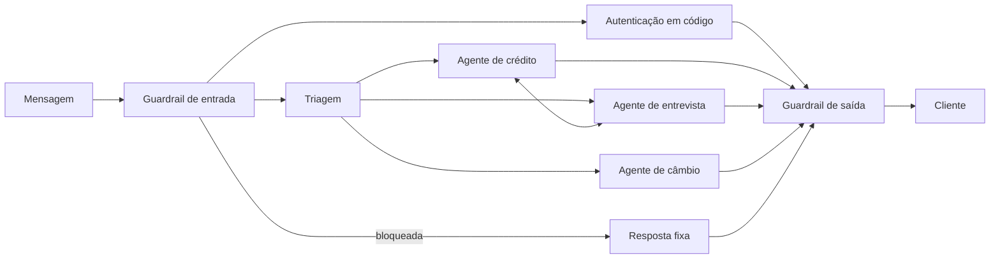

# Banco Ágil

Atendimento digital de um banco fictício, feito por agentes de IA que conversam com o cliente em português, consultam e alteram dados reais (arquivos CSV) e respeitam regras de segurança verificadas por código.

## Visão geral

O cliente conversa com um único atendente. Por trás, um grafo de agentes cuida de cada assunto:

| Assunto | O que o cliente consegue fazer |
|---|---|
| Autenticação | Entrar com CPF e data de nascimento, com até três tentativas |
| Crédito | Consultar o limite e pedir aumento, com resposta imediata |
| Entrevista de crédito | Responder cinco perguntas para recalcular o score |
| Câmbio | Consultar a cotação atual de uma moeda em reais |

A troca entre assuntos é invisível: o cliente nunca vê nomes de agentes nem mensagens de transferência.

## Arquitetura



Detalhes de cada decisão estão em [docs/arquitetura.md](docs/arquitetura.md).

## Funcionalidades

- Autenticação decidida só por código, sem modelo, com mensagens que não revelam qual dado errou.
- Pedido de aumento de limite analisado contra a tabela de faixas de score e registrado em `solicitacoes_aumento_limite.csv`.
- Após uma rejeição, o atendimento oferece a entrevista e, se aceita, reanalisa o mesmo valor com o score novo.
- Entrevista conduzida pelo modelo, com ordem das perguntas e validação das respostas garantidas por código.
- Cotação de moedas vinda de API externa, sempre com valor e horário da consulta.
- Encerramento da conversa a qualquer momento.
- Conversa preservada em SQLite: reiniciar o serviço não obriga a autenticar de novo.
- Guardrails de entrada e de saída atrás de uma interface substituível.

## Desafios enfrentados

- **Modelo não pode decidir quem é o cliente.** O CPF autenticado fica no estado do grafo e é injetado nas ferramentas por código. Nenhuma ferramenta recebe CPF como argumento.
- **Conversa natural com regras rígidas.** A entrevista é livre na redação, mas só avança com uma pergunta por vez, na ordem, e só calcula o score com as cinco respostas válidas.
- **Falhas não podem derrubar o atendimento.** Erros de modelo, de arquivo e de API viram mensagens claras ao cliente; o detalhe vai para o log, com CPF mascarado.
- **Gravação segura de CSV.** Cada alteração escreve em arquivo temporário e renomeia, então uma falha no meio nunca corrompe a base.
- **Limite de uso do modelo gratuito.** Autenticação e regras de segurança rodam sem modelo, e o modelo juiz só é consultado quando uma regra levanta suspeita.

## Escolhas técnicas

| Tema | Escolha | Motivo |
|---|---|---|
| Orquestração | LangGraph, grafo único | Estado compartilhado e roteamento explícito entre agentes |
| Modelo | LiteLLM com `CHAT_MODEL`, `CHAT_MODEL_API_KEY`, `CHAT_MODEL_BASE_URL` | Trocar de provedor só por configuração |
| Dados de negócio | CSV com gravação atômica | Simples de inspecionar e suficiente para o escopo |
| Conversa | SQLite (checkpointer do LangGraph) | Continuidade sem infraestrutura extra |
| Câmbio | AwesomeAPI, valor de compra (`bid`) | Sem chave e com horário da cotação |
| Interface | Streamlit | Tela de conversa simples para testar o fluxo completo |
| Observabilidade | Langfuse, opcional | Traces com CPF mascarado e sem o texto do cliente |
| Testes | pytest com modelo falso roteirizado e HTTP simulado | Executa código real e só mocka dependências externas |

## Como executar

Requisitos: Docker com Compose, ou Python 3.12 com [uv](https://docs.astral.sh/uv/).

1. Crie o arquivo de configuração e preencha as chaves:

   ```bash
   cp .env.example .env
   ```

   | Variável | Obrigatória | Para quê |
   |---|---|---|
   | `CHAT_MODEL` | sim | Identificador do modelo no formato do LiteLLM |
   | `CHAT_MODEL_API_KEY` | sim | Chave do provedor do modelo |
   | `CHAT_MODEL_BASE_URL` | não | Endereço alternativo do provedor |
   | `EXCHANGE_API_BASE_URL` | não | Padrão: `https://economia.awesomeapi.com.br` |
   | `LANGFUSE_PUBLIC_KEY`, `LANGFUSE_SECRET_KEY`, `LANGFUSE_HOST` | não | Ativam o tracing |

2. Suba a aplicação:

   ```bash
   docker compose up
   ```

   O container roda com o seu usuário e grava os dados na pasta local `data/`. O padrão é o usuário `1000:1000`. Se o seu for outro, use `HOST_UID=$(id -u) HOST_GID=$(id -g) docker compose up`. Com podman rootless, use `HOST_UID=0 HOST_GID=0`.

   Sem Docker: `uv sync && uv run streamlit run src/banco_agil/ui/streamlit_app.py`.

3. Abra <http://localhost:8501> e converse.

### Clientes de teste

Todos os dados são fictícios.

| Nome | CPF | Nascimento | Limite | Score |
|---|---|---|---|---|
| Ana Souza | 111.444.777-35 | 17/05/1990 | R$ 5.000,00 | 650 |
| Bruno Lima | 529.982.247-25 | 02/11/1985 | R$ 1.000,00 | 300 |
| Carla Mendes | 390.533.447-05 | 28/03/1992 | R$ 3.000,00 | 501 |
| Diego Alves | 168.995.350-09 | 09/08/1978 | R$ 40.000,00 | 850 |
| Elisa Prado | 745.191.268-00 | 30/01/2001 | R$ 8.000,00 | 700 |
| Fábio Teixeira | 281.456.379-37 | 12/12/1969 | R$ 500,00 | 0 |

Na primeira execução, a aplicação cria a pasta `data/` com esses clientes e com as faixas de score. Arquivos que já existem nunca são sobrescritos. A pasta não é versionada.

Para voltar ao estado inicial, pare a aplicação e apague a pasta: `rm -r data`. Os arquivos ficam em `data/`, incluindo `data/solicitacoes_aumento_limite.csv` e o banco de conversas em `data/runtime/`.

### Testes e qualidade

```bash
uv run pytest
uv run ruff check src tests
uv run mypy src
```
