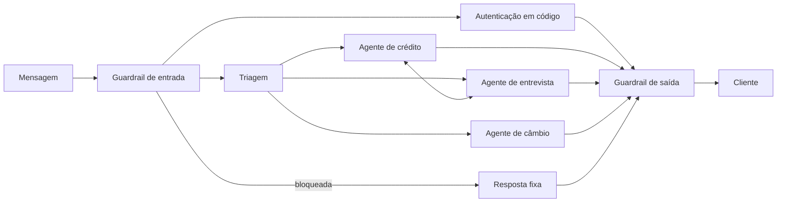

# Banco Ágil

Atendimento digital de um banco fictício, feito por agentes de IA que conversam com o cliente em português, consultam e alteram dados reais (arquivos CSV) e respeitam regras de segurança verificadas por código.

## Visão geral

O cliente conversa com um único atendente. Por trás, um grafo de agentes cuida de cada assunto:

| Assunto | O que o cliente consegue fazer |
|---|---|
| Autenticação | Entrar com CPF e data de nascimento, com até três tentativas |
| Crédito | Consultar o limite e pedir aumento, com resposta imediata |
| Entrevista de crédito | Responder cinco perguntas para recalcular o score |
| Câmbio | Consultar a cotação atual de uma moeda em reais |

A troca entre assuntos é invisível: o cliente nunca vê nomes de agentes nem mensagens de transferência.

## Arquitetura



### Agentes e dados

| Agente | Função | Dados que lê e grava |
|---|---|---|
| Triagem | Saúda, coleta CPF e data de nascimento, autentica (em código) e encaminha pelo assunto | Lê `clientes.csv` |
| Crédito | Consulta o limite, analisa e registra pedidos de aumento, oferece a entrevista após uma rejeição | Lê `clientes.csv` e `score_limite.csv`; grava `solicitacoes_aumento_limite.csv` e, quando aprovado, o limite em `clientes.csv` |
| Entrevista de crédito | Faz as cinco perguntas, calcula o score e devolve o cliente ao crédito | Grava o score em `clientes.csv` |
| Câmbio | Consulta a cotação de uma moeda e fecha a consulta com cordialidade | Consulta a API externa; não usa arquivos |

Todos os arquivos ficam em `data/` e são alterados por repositórios próprios, com gravação atômica. O estado da conversa (CPF autenticado, agente ativo, pedido pendente, respostas da entrevista) fica no grafo e é salvo em SQLite.

Detalhes de cada decisão estão em [docs/arquitetura.md](docs/arquitetura.md).

## Funcionalidades

- Autenticação decidida só por código, sem modelo, com mensagens que não revelam qual dado errou.
- Pedido de aumento de limite analisado contra a tabela de faixas de score e registrado em `solicitacoes_aumento_limite.csv`. Valor igual ou menor que o limite atual é recusado com orientação, sem registro e sem alterar o limite.
- Após uma rejeição, o atendimento oferece a entrevista e, se aceita, reanalisa o mesmo valor com o score novo.
- Entrevista conduzida pelo modelo, com ordem das perguntas e validação das respostas garantidas por código.
- Cotação de moedas vinda de API externa, sempre com valor e horário da consulta.
- Encerramento da conversa a qualquer momento.
- Conversa preservada em SQLite: reiniciar o serviço não obriga a autenticar de novo.
- Guardrails de entrada e de saída atrás de uma interface substituível.

## Desafios enfrentados

### Desafios técnicos

- **Modelo não pode decidir quem é o cliente.** O CPF autenticado fica no estado do grafo e é injetado nas ferramentas por código. Nenhuma ferramenta recebe CPF como argumento.
- **Conversa natural com regras rígidas.** A entrevista é livre na redação, mas só avança com uma pergunta por vez, na ordem, e só calcula o score com as cinco respostas válidas.
- **Falhas não podem derrubar o atendimento.** Erros de modelo, de arquivo e de API viram mensagens claras ao cliente; o detalhe vai para o log, com CPF mascarado.
- **Gravação segura de CSV.** Cada alteração escreve em arquivo temporário e renomeia, então uma falha no meio nunca corrompe a base.
- **Limite de uso do modelo gratuito.** Autenticação e regras de segurança rodam sem modelo, e o modelo juiz só é consultado quando uma regra levanta suspeita.

### Decisões em pontos que o enunciado não define

O enunciado deixa lacunas e ambiguidades. Cada decisão abaixo foi tomada de forma explícita, com o motivo.

#### Autenticação

| Decisão | Motivo |
|---|---|
| Três falhas seguidas encerram o atendimento (a primeira tentativa mais as duas novas do enunciado) | Segue o texto do enunciado, sem tentativa extra |
| Falha de CPF e falha de data geram a mesma mensagem | Evita revelar qual dado está certo |
| CPF com dígitos verificadores inválidos ou com formato ilegível conta como tentativa | Evita que erros de digitação ou testes de força bruta escapem do limite |
| A autenticação não usa o modelo | Um texto do cliente ("já estou autenticado") não pode substituir a verificação |

#### Crédito

| Decisão | Motivo |
|---|---|
| Faixas de score definidas em `score_limite.csv`: 0–300 até R$ 1.000, 301–500 até R$ 5.000, 501–700 até R$ 15.000, 701–1000 até R$ 40.000 | O enunciado cita a tabela, mas não os valores. As faixas são fictícias e editáveis no arquivo |
| O teto de cada faixa é inclusivo: pedir exatamente o teto é aprovado, e um centavo acima é rejeitado | Evita ambiguidade na fronteira |
| Status gravados como `aprovado` e `rejeitado` | O enunciado usa "rejeitado" na coluna e "reprovado" no texto. Adotei um só termo para facilitar filtros |
| Pedido aprovado atualiza o limite em `clientes.csv` | Sem isso, a consulta seguinte mostraria o limite antigo e o atendimento ficaria incoerente |
| Valor igual ou menor que o limite atual é recusado, sem registro e sem alterar o limite | Um pedido de aumento nunca deve reduzir o limite. Reduzir é outra operação, que exigiria confirmação do cliente |
| Pedido rejeitado informa o teto do score atual | Dá ao cliente um valor possível para tentar de novo |
| Após a rejeição, o atendimento oferece a entrevista e, se aceita, reanalisa o mesmo valor por código | O cliente não precisa repetir o pedido, e o resultado não depende de o modelo lembrar |

#### Entrevista

| Decisão | Motivo |
|---|---|
| O modelo conduz a conversa, e o código controla ordem, validação e cálculo | Conversa natural (adequada a canais como o WhatsApp) sem abrir mão de regras exatas |
| Uma pergunta por vez, na ordem do enunciado | Evita respostas misturadas e respostas fora de ordem |
| Respostas naturais ("CLT", "uns 8 mil", "dois filhos") são aceitas e convertidas | O cliente não deve precisar reescrever o que já foi entendido |
| Resposta ambígua ou contraditória é recusada (por exemplo, "CLT e também MEI") | É melhor perguntar de novo do que calcular um score com dado duvidoso |
| Após duas falhas na mesma pergunta, o atendimento oferece pausar ou parar | Evita um laço de perguntas repetidas |
| A fórmula do enunciado é aplicada como está: 3 ou mais dependentes pesam 30, arredondamento comercial, resultado limitado a 0–1000 | Mantém a fórmula pedida e garante a faixa de 0 a 1000 |
| Desistir no meio não altera o score | O score só é gravado com as cinco respostas válidas |

#### Câmbio

| Decisão | Motivo |
|---|---|
| AwesomeAPI, que não exige chave | Qualquer pessoa executa o projeto sem criar conta em outro serviço |
| Usa o valor de compra (`bid`) em reais | Um único valor, claro para o cliente |
| Sem moeda informada, consulta o dólar | O enunciado cita o dólar como padrão |
| Toda resposta traz valor, moeda e horário da consulta | Deixa claro que a cotação é de um instante |
| Moeda desconhecida ou API fora do ar nunca produz um valor inventado | Um número errado é pior que nenhuma resposta |

#### Segurança e conduta

| Decisão | Motivo |
|---|---|
| O CPF autenticado fica no estado do grafo, e nenhuma ferramenta o recebe como argumento | O modelo não consegue consultar outro cliente |
| Guardrails de entrada e de saída atrás de uma interface substituível | Permite trocar por um serviço gerenciado sem mexer nos agentes |
| Regras locais decidem os casos claros, e o modelo juiz só é chamado em caso de suspeita | Economiza chamadas e custo |
| Se o juiz falhar, a mensagem é bloqueada | Na dúvida, o sistema escolhe o lado seguro |
| O juiz usa o mesmo tempo limite do modelo do atendimento (60 s, até 3 tentativas) | Quem administra escolhe um modelo rápido em `JUDGE_CHAT_MODEL`, sem um limite fixo próprio |
| Três bloqueios seguidos encerram o atendimento | Limita tentativas repetidas de manipulação |
| Respostas com CPF, limite ou score de outro cliente são trocadas por uma resposta segura | Última barreira contra vazamento, mesmo que um agente erre |
| Respostas não mencionam agentes, ferramentas nem transferências | Cumpre a regra de que o cliente percebe um único atendente |

#### Sessão e dados

| Decisão | Motivo |
|---|---|
| A conversa é salva em SQLite | Reiniciar o serviço não obriga o cliente a se autenticar de novo |
| Conversa inativa por 5 minutos é encerrada (configurável, `0` desliga) | Evita deixar uma sessão autenticada aberta |
| Os dados de teste são criados na primeira execução e a pasta `data/` não é versionada | Execução simples e sem risco de sobrescrever dados existentes |
| Logs e traces mascaram o CPF e não registram o texto do cliente | Privacidade dos dados, inclusive em ferramentas de observabilidade |

## Escolhas técnicas

| Tema | Escolha | Motivo |
|---|---|---|
| Orquestração | LangGraph, grafo único | Estado compartilhado e roteamento explícito entre agentes |
| Modelo | LiteLLM com `CHAT_MODEL_*` para o atendimento e `JUDGE_CHAT_MODEL_*` para o juiz dos guardrails | Trocar de provedor só por configuração; o juiz pode ser um modelo distinto, mais barato ou independente |
| Dados de negócio | CSV com gravação atômica | Simples de inspecionar e suficiente para o escopo |
| Conversa | SQLite (checkpointer do LangGraph) | Continuidade sem infraestrutura extra |
| Câmbio | AwesomeAPI, valor de compra (`bid`) | Sem chave e com horário da cotação |
| Interface | Streamlit | Tela de conversa simples para testar o fluxo completo |
| Observabilidade | Langfuse, opcional | Traces com CPF mascarado e sem o texto do cliente |
| Testes | pytest com modelo falso roteirizado e HTTP simulado | Executa código real e só mocka dependências externas |

## Estrutura do código

```text
src/banco_agil/
├── domain/       Regras puras: CPF, autenticação, regras de crédito e fórmula do score
├── storage/      Repositórios CSV com gravação atômica
├── graph/        Estado, nós de cada agente, guardrails e montagem do grafo
├── tools/        Ferramentas de cada agente, com o CPF já injetado por código
├── exchange/     Interface de cotação e cliente da API de câmbio
├── guardrails/   Interface, regras locais e modelo juiz
├── seed/         Criação dos dados de teste na primeira execução
├── ui/           Tela Streamlit
├── service.py    Ponto de entrada da conversa: persistência e tratamento de erros
├── config.py     Variáveis de ambiente
└── llm.py        Fábrica dos modelos (atendimento e juiz)
tests/            Testes de regras, agentes, guardrails, armazenamento e tela
```

## Como executar

Requisitos: Docker com Compose, ou Python 3.12 com [uv](https://docs.astral.sh/uv/).

1. Crie o arquivo de configuração e preencha as chaves:

   ```bash
   cp .env.example .env
   ```

   | Variável | Obrigatória | Para quê |
   |---|---|---|
   | `CHAT_MODEL` | sim | Identificador do modelo no formato do LiteLLM. Exemplo: `gemini/gemini-flash-latest` |
   | `CHAT_MODEL_API_KEY` | sim | Chave do provedor do modelo. Para o Gemini, gere em <https://ai.google.dev/gemini-api/docs/api-key> |
   | `CHAT_MODEL_BASE_URL` | não | Endereço alternativo do provedor |
   | `JUDGE_CHAT_MODEL` | sim | Modelo dos guardrails (juiz), configurado à parte do modelo do atendimento, no formato do LiteLLM. Prefira um modelo rápido |
   | `JUDGE_CHAT_MODEL_API_KEY` | sim | Chave do provedor do modelo juiz |
   | `JUDGE_CHAT_MODEL_BASE_URL` | não | Endereço alternativo do provedor do juiz |
   | `EXCHANGE_API_BASE_URL` | não | Padrão: `https://economia.awesomeapi.com.br` |
   | `SESSION_TIMEOUT_SECONDS` | não | Encerra a conversa após esse tempo sem mensagens. Padrão: `300`. Com `0`, desliga |
   | `LANGFUSE_PUBLIC_KEY`, `LANGFUSE_SECRET_KEY`, `LANGFUSE_HOST` | não | Ativam o tracing |

2. Suba a aplicação:

   ```bash
   docker compose up --build
   ```

   O container grava os dados na pasta local `data/`, com o usuário `1000:1000` por padrão. O comando acima basta na maioria dos casos. Se o seu usuário for outro e você quiser os arquivos no seu nome, use `HOST_UID=$(id -u) HOST_GID=$(id -g) docker compose up --build`. Com podman rootless, use `HOST_UID=0 HOST_GID=0`. Depois de atualizar o código com um container já criado, rode `docker compose down` antes.

   Sem Docker: `uv sync && uv run streamlit run src/banco_agil/ui/streamlit_app.py`.

3. Abra <http://localhost:8501> e converse.

### Clientes de teste

Todos os dados são fictícios.

| Nome | CPF | Nascimento | Limite | Score |
|---|---|---|---|---|
| Ana Souza | 111.444.777-35 | 17/05/1990 | R$ 5.000,00 | 650 |
| Bruno Lima | 529.982.247-25 | 02/11/1985 | R$ 1.000,00 | 300 |
| Carla Mendes | 390.533.447-05 | 28/03/1992 | R$ 3.000,00 | 501 |
| Diego Alves | 168.995.350-09 | 09/08/1978 | R$ 40.000,00 | 850 |
| Elisa Prado | 745.191.268-00 | 30/01/2001 | R$ 8.000,00 | 700 |
| Fábio Teixeira | 281.456.379-37 | 12/12/1969 | R$ 500,00 | 0 |

Na primeira execução, a aplicação cria a pasta `data/` com esses clientes e com as faixas de score. Arquivos que já existem nunca são sobrescritos. A pasta não é versionada.

Para voltar ao estado inicial, pare a aplicação e apague a pasta: `rm -r data`. Os arquivos ficam em `data/`, incluindo `data/solicitacoes_aumento_limite.csv` e o banco de conversas em `data/runtime/`.

### Roteiro de teste manual

Com os clientes acima, três conversas cobrem o atendimento completo. Use "Nova conversa" entre elas.

1. **Aumento rejeitado, entrevista e aprovação** (Bruno Lima)
   1. Informe o CPF `529.982.247-25` e a data `02/11/1985`.
   2. Peça aumento do limite para R$ 3.000. O score é 300, o teto da faixa é R$ 1.000, então o pedido é rejeitado e a entrevista é oferecida.
   3. Aceite e responda: renda de R$ 5.000, emprego formal, despesas de R$ 2.000, nenhum dependente e nenhuma dívida. O score novo é 575.
   4. O pedido de R$ 3.000 é reanalisado e aprovado. Confira `data/clientes.csv` (limite e score) e `data/solicitacoes_aumento_limite.csv` (duas linhas: rejeitado e aprovado).
2. **Falha de autenticação**: informe CPF e data que não conferem três vezes seguidas. O atendimento é encerrado com uma despedida educada.
3. **Câmbio e encerramento** (Ana Souza, CPF `111.444.777-35`, nascimento `17/05/1990`): pergunte a cotação do dólar, depois a do euro, e peça para encerrar.

### Testes e qualidade

```bash
uv run pytest
uv run ruff check src tests
uv run mypy src
```
